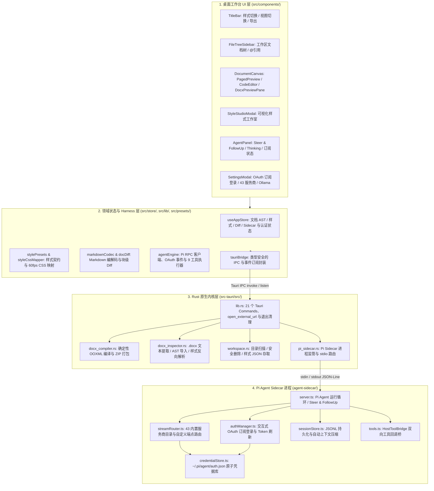
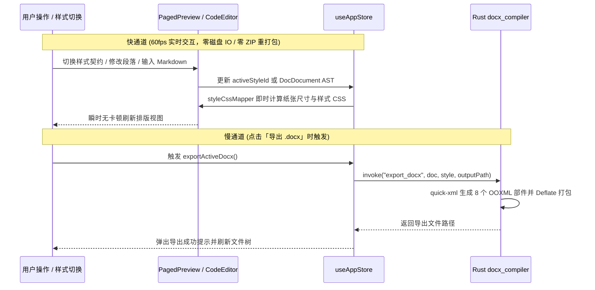
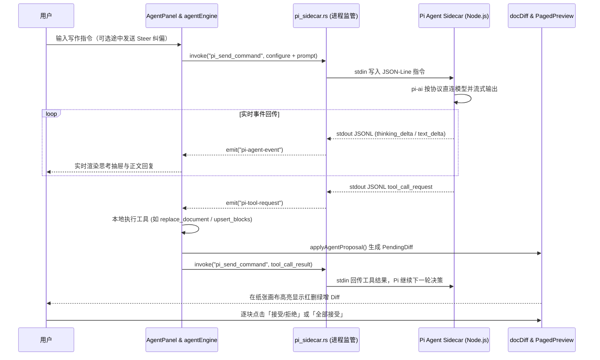
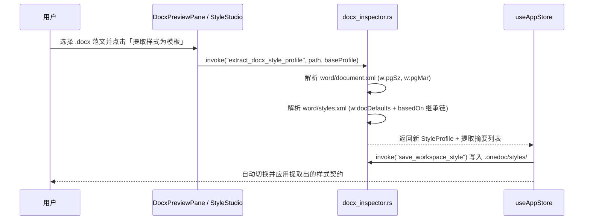

# OneDoc 系统架构文档

本文档描述 OneDoc 桌面端系统的分层架构、核心运行时数据流、Tauri IPC 契约与本地数据持久化布局。

---

## 1. 整体分层架构

OneDoc 采用 **“前端实时交互画布 + Rust 原生高性能内核 + Pi Agent Sidecar 后端”** 的协同架构：

---

## 2. 各层职责边界

### 2.1 UI 工作台层 (`src/components/`)

| 组件文件 | 核心职责 |
| :--- | :--- |
| [TitleBar.tsx](../src/components/TitleBar.tsx) | 顶部控制栏：工作区挂载入口、样式契约下拉即时切换、视图模式切换（`排版预览` / `分屏` / `Markdown 源码`）、撤销、保存、`.docx` 编译导出与模型设置入口 |
| [FileTreeSidebar.tsx](../src/components/FileTreeSidebar.tsx) | 左侧文件树：扫描过滤 `.onedoc.json` / `.docx` / `.md` / `.txt`，支持新建文档、一键生成示例工作区、点击悬停 `📎` 附加为 Agent `@参考资料` |
| [DocumentCanvas.tsx](../src/components/DocumentCanvas.tsx) | 中央画布路由与状态栏：根据当前文件类型分派至 `DocxPreviewPane` 或 `CodeEditor` + `PagedPreview`，底部展示纸张规格、正文字体、区块数、字数及缩放控制 |
| [PagedPreview.tsx](../src/components/PagedPreview.tsx) | 核心分页排版预览器：按真实毫米比例渲染纸张、页眉页脚与页码，支持单击选中区块触发 AI 局部改写、双击直接文字微调、上下移动与删除，以及块级红/绿 Diff 审阅浮条 |
| [CodeEditor.tsx](../src/components/CodeEditor.tsx) | 基于 CodeMirror 6 的高性能源码编辑器（行号、语法高亮、软换行、`Ctrl+S` 保存、120ms 防抖同步至 AST） |
| [DocxPreviewPane.tsx](../src/components/DocxPreviewPane.tsx) | 基于 `docx-preview` (`renderAsync`) 渲染外部 `.docx`，并提供「提取样式为模板」与「导入为可编辑文档」入口 |
| [StyleStudioModal.tsx](../src/components/StyleStudioModal.tsx) | 样式工作室：3 个分类页签（字体与段落 / 页面与页眉页脚 / 多级编号与表格）+ 实时缩略样张预览 + 从 `.docx` 范文提取样式按钮 |
| [AgentPanel.tsx](../src/components/AgentPanel.tsx) | 右侧 Pi Agent Harness：显示 Sidecar 在线灯、OAuth/订阅登录状态徽标与未认证直达入口、激活上下文胶囊、可折叠 Thinking 思考抽屉、工具卡片、Steer / FollowUp 与压缩触发器 |
| [SettingsModal.tsx](../src/components/SettingsModal.tsx) | 三栏模型接入中心：**订阅账号登录**（Claude Pro/Max、ChatGPT Plus/Pro & Codex、GitHub Copilot、Kimi Code 等 9 家 OAuth，实时展示设备码/授权链接与交互式回调确认）、**内置 API 服务商**（43 家目录与模型选择）、**自定义 / Ollama** |

### 2.2 领域状态与 Harness 层 (`src/`)

- **[useAppStore.ts](../src/store/useAppStore.ts)**：单一前端真相源，持有工作区文件树、当前 `DocDocument` AST、`rawText`、20 步 `undoStack`、`pendingDiff`、自定义 `StyleProfile` 列表、`selectedBlockIds`、`piSidecarStatus`、`providerCatalog`（43 家服务商认证/模型目录）、交互式 `authUiState`（OAuth 进度/提示/设备码状态）与 `messages`。
- **[styleCssMapper.ts](../src/lib/styleCssMapper.ts)**：前端 CSS 排版映射器，与 Rust `docx_compiler.rs` 共享完全一致的中文数字转换（`一、二、...二十一`）与 `{zh1}` / `{n1}` 标题编号规则，保证预览与导出 `.docx` 一致。
- **[markdownCodec.ts](../src/lib/markdownCodec.ts)**：确定性 Markdown ↔ `DocDocument` AST 双向编解码器，支持 `#`~`#####` 标题、`> [!NOTE]` 提示框、管道表格、代码块、列表、`===` 红头双线与 `<!-- pagebreak -->`。
- **[docDiff.ts](../src/lib/docDiff.ts)**：基于 `block.id` 对齐的块级 Diff 计算器，生成 `unchanged` / `added` / `modified` / `deleted` 条目并支持逐块独立 `Accept` / `Reject`。
- **[agentEngine.ts](../src/lib/agentEngine.ts)**：桌面端默认接入 Pi Agent Sidecar JSONL RPC 客户端（处理 `providers_catalog` 与 `auth_*` 交互认证事件、双向工具回调、`steer` / `followUp`、Thinking 与上下文压缩事件），首次无本地配置时会自动继承 `~/.pi/agent/auth.json` 中已登录的订阅服务商；同时保留纯浏览器预览模式下的 `fetch` SSE 回退路径。

### 2.3 Rust 原生内核层 (`src-tauri/src/`)

- **[lib.rs](../src-tauri/src/lib.rs)**：注册全部 **21 个** Tauri 命令与退出前子进程清理钩子，并提供带 `http://` / `https://` 白名单校验的 `open_external_url`（Windows 下通过 `$env:ONEDOC_OPEN_URL` 与 `CREATE_NO_WINDOW` 静默唤起 PowerShell `Start-Process` 打开浏览器完成 OAuth 授权，macOS/Linux 分别调用 `open` 与 `xdg-open`）。
- **[models.rs](../src-tauri/src/models.rs)**：与 TypeScript 严格对称的强类型模型（`#[serde(rename_all = "camelCase")]` 与 `DocBlock` 标签联合体）。
- **[docx_compiler.rs](../src-tauri/src/docx_compiler.rs)**：使用 `zip` + `quick-xml` 直接生成内存/磁盘 `.docx`，完全不依赖外部 Office 或 Python。
- **[docx_inspector.rs](../src-tauri/src/docx_inspector.rs)**：解包分析外部 `.docx` 的 `word/document.xml` 与 `word/styles.xml`（解析 `basedOn` 与 `docDefaults` 继承链）。
- **[workspace.rs](../src-tauri/src/workspace.rs)**：递归扫描工作区（深度上限 6 层，忽略 `.git` / `node_modules` / `target` 等）、安全路径校验、样式目录读写及示例工程脚手架。
- **[pi_sidecar.rs](../src-tauri/src/pi_sidecar.rs)**：异步监管 Node.js Pi Sidecar 子进程（Windows 自动加 `CREATE_NO_WINDOW`），负责 `stdin` JSONL 投递、`stdout` 路由到 `pi-tool-request` / `pi-agent-event` 事件，并在应用退出时清理子进程。
- **[llm_proxy.rs](../src-tauri/src/llm_proxy.rs)**：保留的轻量直连 SSE 代理（与 Sidecar 并存兼容）。

### 2.4 Pi Agent Sidecar 后端层 (`agent-sidecar/src/`)

- **[credentialStore.ts](../agent-sidecar/src/credentialStore.ts)**：`FileCredentialStore` 实现 Pi 的 `CredentialStore` 接口，面向 `$PI_CODING_AGENT_DIR/auth.json`（默认 `~/.pi/agent/auth.json`）提供按服务商维度的异步互斥串行化与临时文件原子重命名写入，原生共享 `pi` CLI 的订阅登录态。
- **[authManager.ts](../agent-sidecar/src/authManager.ts)**：`PiAuthManager` 驱动 `models.login(providerId, authType, interaction, { agentName: "OneDoc" })`，实时转发 `auth_url`、`device_code`、`info`、`progress` 与交互式问答提示，监听 `prompt.signal` 取消信号并在本地回调完成后发出 `auth_prompt_cancelled`，同时支持 `logout` 与 API Key 存储。
- **[streamRouter.ts](../agent-sidecar/src/streamRouter.ts)**：挂载 `builtinModels({ credentials: credentialStore })`（全部 43 家内置服务商与 9 家 OAuth 订阅认证）与 `syncCustomProvider()`（自定义端点 / Ollama 隔离为 `"custom-endpoint"`）；调用 `piModels.streamSimple()` 时对内置服务商保持 OAuth 凭据自动解析与续期路径不被 `options.apiKey` 覆盖。
- **[server.ts](../agent-sidecar/src/server.ts)**：实例化 `@earendil-works/pi-agent-core` 的 `Agent` 运行时（不注入静态 `getApiKey`，将鉴权完全交由 Pi CredentialStore 管理；支持顺序工具执行、单条队列 Steer/FollowUp、消息量 >24 或估算 Token >60k 时触发 `transformContext` 自动压缩），启动时主动派发 `providers_catalog` 并处理认证与对话 RPC 指令。
- **[tools.ts](../agent-sidecar/src/tools.ts)**：注册全部 9 个 OneDoc `AgentTool`，通过 `HostToolBridge` 以 `tool_call_request` / `tool_call_result` 双向回调宿主工作台。
- **[sessionStore.ts](../agent-sidecar/src/sessionStore.ts)**：将每次运行的新增消息追加持久化到 `<workspace>/.onedoc/sessions/<sessionId>.jsonl`，并提供调用 `streamFn` 生成结构化中文摘要的会话压缩器。
- **[protocol.ts](../agent-sidecar/src/protocol.ts)**：定义严格的 JSONL RPC 指令（含 `list_providers` / `login_start` / `login_prompt_response` / `login_cancel` / `logout` / `set_api_key`）与事件联合类型，并将诊断日志隔离至 `stderr`。

---

## 3. 核心运行时数据流

### 3.1 快慢双通道文档流（编辑流畅度 vs OOXML 保真）

### 3.2 Pi Agent Sidecar 双向 JSONL RPC 与块级 Diff 审核流

### 3.3 外部 `.docx` 范文样式提取与语义导入

---

## 4. Tauri IPC 接口与事件清单

在 [lib.rs](../src-tauri/src/lib.rs) 中注册了全部 21 个后端命令：

| 类别 | 命令名 | 参数与返回值摘要 | 实现模块 |
| :--- | :--- | :--- | :--- |
| **工作区管理** | `scan_workspace` | `(rootPath) -> FileTreeNode[]` | `workspace.rs` |
| | `read_workspace_file` | `(path) -> WorkspaceFileContent` | `workspace.rs` |
| | `read_text_file` | `(path) -> string` | `workspace.rs` |
| | `write_text_file` | `(path, content) -> void` | `workspace.rs` |
| | `read_file_base64` | `(path) -> string`（供 `docx-preview` 渲染） | `workspace.rs` |
| | `delete_workspace_file` | `(workspaceRoot, filePath) -> void`（校验防越界） | `workspace.rs` |
| | `create_sample_workspace` | `(targetDir) -> string` | `workspace.rs` |
| **系统安全外链** | `open_external_url` | `(url) -> void`（校验 `http://` / `https://` 后安全打开系统浏览器） | `lib.rs` |
| **样式持久化** | `load_workspace_styles` | `(rootPath) -> StyleProfile[]` | `workspace.rs` |
| | `save_workspace_style` | `(rootPath, profile) -> void` | `workspace.rs` |
| **DOCX 引擎** | `export_docx` | `(doc, style, outputPath) -> string` | `docx_compiler.rs` |
| | `extract_docx_style_profile` | `(path, baseProfile) -> ExtractedStyleResult` | `docx_inspector.rs` |
| | `import_docx_to_ast` | `(path, styleProfileId) -> DocDocument` | `docx_inspector.rs` |
| | `extract_docx_text` | `(path) -> string` | `docx_inspector.rs` |
| **Pi Agent Sidecar** | `pi_sidecar_status` | `() -> PiSidecarStatus` | `pi_sidecar.rs` |
| | `pi_start_sidecar` | `() -> PiSidecarStatus` | `pi_sidecar.rs` |
| | `pi_send_command` | `(commandJson) -> void` | `pi_sidecar.rs` |
| | `pi_stop_sidecar` | `() -> void` | `pi_sidecar.rs` |
| **兼容 SSE 代理** | `llm_chat_stream` | `(requestId, baseUrl, apiKey, payloadJson) -> void` | `llm_proxy.rs` |
| | `llm_cancel_stream` | `(requestId) -> void` | `llm_proxy.rs` |
| | `llm_test_connection` | `(baseUrl, apiKey, model) -> string` | `llm_proxy.rs` |

异步事件（由 Rust 后端发往前端）：
- `pi-agent-event`：Pi Sidecar 发出的 `ready`、`state`、`providers_catalog`、`auth_event`（`auth_url` / `device_code` / `info` / `progress`）、`auth_prompt`、`auth_prompt_cancelled`、`auth_complete`、`auth_error`、`agent_event`（`text_delta` / `thinking_delta` / `tool_execution_*` / `agent_end`）、`compacted`、`test_connection_result` 与 `error` 事件。
- `pi-tool-request`：`{ callId, name, args }`（Sidecar 发起的宿主工具调用请求，前端执行后通过 `pi_send_command` 回传 `tool_call_result`）。
- `llm-stream-chunk` / `llm-stream-done` / `llm-stream-error`：保留的 `llm_proxy.rs` 兼容流式事件。

---

## 5. Agent 内置工具集 (`agentEngine.ts`)

目前系统向模型暴露了 **9 个高语义工具**，刻意隐藏底层 OOXML 细节：

1. `inspect_style_profile`：读取当前激活的完整 `StyleProfile` 及可用样式 ID 列表。
2. `get_document_outline`：获取当前文档标题、样式 ID 及每个区块的 ID、类型与摘要预览。
3. `read_document_blocks`：按 `blockIds` 或 `[startIndex, endIndex]` 按需读取区块详情。
4. `list_workspace_files`：列出工作区内所有受支持文档的相对路径与类型。
5. `read_workspace_file`：读取 `.md` / `.txt` / `.onedoc.json` 或自动提取 `.docx` 纯文本（单次上限 12,000 字符）。
6. `replace_document`：生成或整体重构 `DocBlock[]`，提交至 `PendingDiff` 审核队列。
7. `upsert_blocks`：按 `replace` / `insert_after` / `append` 模式局部增删改区块，提交至 `PendingDiff`。
8. `update_style_profile`：切换内置预置样式 ID，或微调正文字体、字号、行距、缩进、表格样式与编号开关。
9. `export_docx`：调用 Rust 编译器导出 `.docx` 文件。

---

## 6. 数据与文件持久化布局

- **语义文档源文件**：`<workspace>/*.onedoc.json`（JSON 格式存储 `DocDocument` AST 及绑定的 `styleProfileId`）。
- **自定义样式目录**：`<workspace>/.onedoc/styles/<styleId>.json`（工作区扫描时默认跳过 `.` 开头目录，避免干扰用户文档树，但由 `load_workspace_styles` 专属加载）。
- **Pi Agent 会话记录**：`<workspace>/.onedoc/sessions/<sessionId>.jsonl`（由 `sessionStore.ts` 按轮次追加存储对话与工具记录）。
- **Pi 订阅与 API 凭据存储**：`$PI_CODING_AGENT_DIR/auth.json`（默认 `~/.pi/agent/auth.json`，Windows 下为 `%USERPROFILE%\.pi\agent\auth.json`），存储 OAuth Access/Refresh Token 与内置服务商 API Key，并与原生 `pi` CLI 共享登录态。
- **本机应用配置 (`localStorage`)**：
  - `onedoc.providerConfig.v1`：接入模式 `mode`（`"builtin" | "custom"`）、`providerId`、自定义 Base URL / API Key / 协议（`api`）、`model`、`temperature` 与 `thinkingLevel`（向后兼容旧版配置迁移）。
  - `onedoc.customStyles.v1`：跨工作区保留的自定义样式列表。
  - `onedoc.lastWorkspace.v1`：上次打开的工作区绝对路径，启动时自动恢复。
